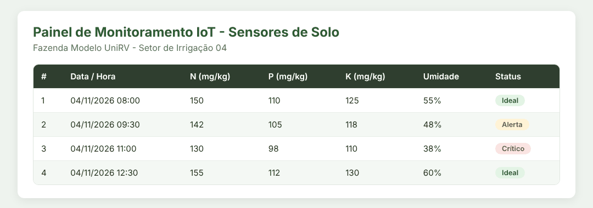

# AgroSensorWeb — Painel de Monitoramento IoT (Sensores de Solo)

Atividade prática **"Criação de Projeto Angular e Componente de Sensores IoT"**
Disciplina: ESW239 — Desenvolvimento de Software para Web · Prof. Me. Sergio Souza Novak · UniRV

## Identificação do aluno

| Campo | Valor |
|---|---|
| Nome completo | Fernanda Oliveira Lino |
| Matrícula UniRV | 23207SFT013 |

## Sobre o projeto

Aplicação Angular (SPA + TypeScript) criada com o Angular CLI para o estudo de caso
**Monitoramento Agrícola IoT**. O componente `container-tabela` exibe as leituras dos
sensores de solo: Nitrogênio (N), Fósforo (P), Potássio (K), Umidade, Data/Hora e Status.

Estrutura principal:

```
src/app/
├── interfaces/
│   └── sensores.interface.ts          # interface LeituraSolo (tipagem dos dados)
├── container-tabela/
│   ├── container-tabela.component.ts   # lógica + vetor de leituras
│   ├── container-tabela.component.html # template da tabela (*ngFor)
│   └── container-tabela.component.css  # estilos (zebra, cabeçalho escuro, badges)
├── app.ts                              # componente raiz (importa ContainerTabelaComponent)
└── app.html                            # <app-container-tabela></app-container-tabela>
```

> Observação: nas versões recentes do Angular CLI o componente raiz é gerado como
> `app.ts` / `app.html` (equivalentes a `app.component.ts` / `app.component.html`).

## Instalação e execução

Pré-requisitos: [Node.js](https://nodejs.org/) (LTS) e Angular CLI (`npm install -g @angular/cli`).

```bash
git clone https://github.com/Fernanda-Linoo/agro-sensor-web.git
cd agro-sensor-web
npm install
ng serve --open
```

A aplicação abre em `http://localhost:4200`.

Para rodar os testes: `ng test`.

## Captura de tela

Tabela de sensores renderizada no navegador em `http://localhost:4200`:



## Etapas implementadas (histórico de commits)

1. Criação e inicialização do projeto com `ng new agro-sensor-web`
2. Interface de dados `LeituraSolo` em TypeScript
3. Geração do componente `container-tabela` via Angular CLI
4. Lógica do componente e conjunto de dados de teste
5. Template HTML da tabela e estilização (zebra, cabeçalho escuro, status coloridos)
6. Integração no componente raiz
7. Documentação e publicação no GitHub
